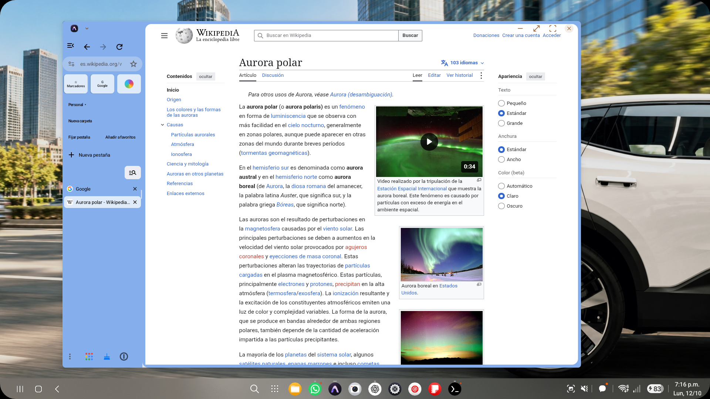
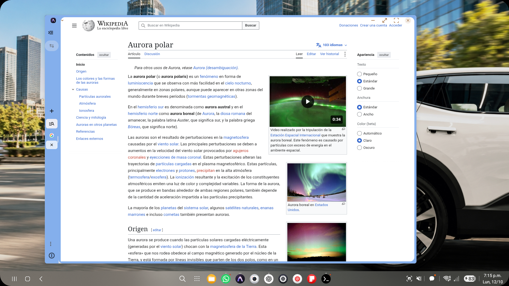
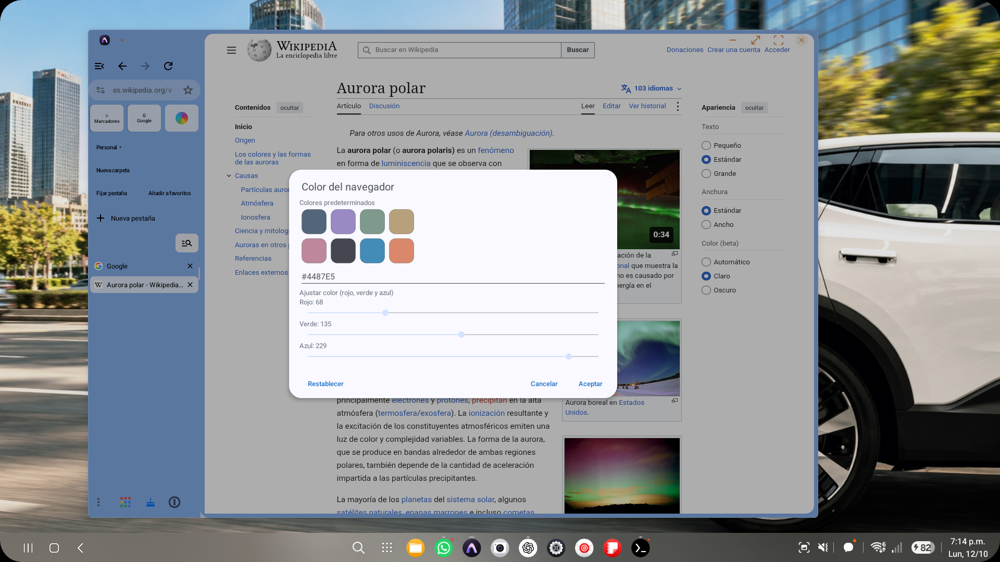
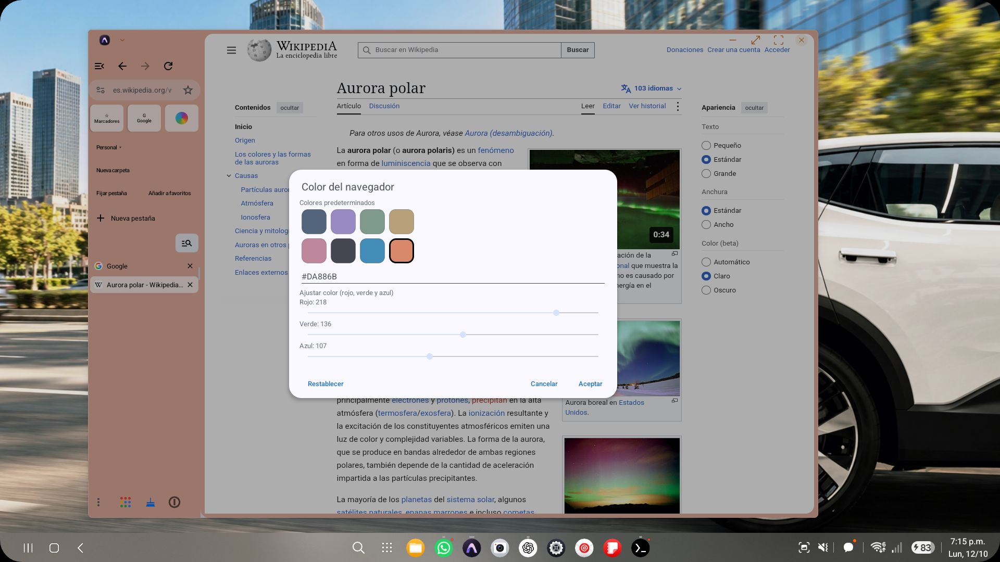
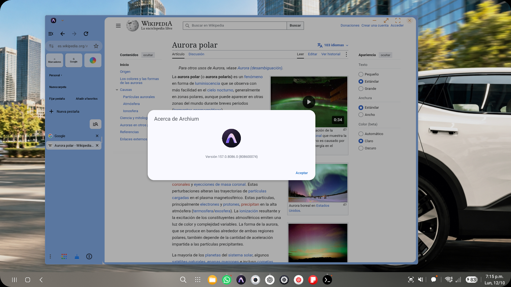

# Archium on Samsung DeX

[← README](../README.md) · [Download and install](INSTALL_ARCHIUM.md)

Five actual screenshots of APK **157.0.8086.0**, captured on a Samsung SM-S931B running Android 16 with a 1920 × 1080 DeX display. These are direct PNGs from `adb screencap`, without retouching or reconstructed UI. Other windows were minimized before capture. The app and example page are shown in Spanish.

The visible browsing content is the public [Aurora polar article on Wikipedia](https://es.wikipedia.org/wiki/Aurora_polar). Article and image credits are available on that page. The wallpaper and taskbar belong to the device's desktop, not Archium.

## Expanded sidebar

Tabs on the left, favorite shortcuts, an integrated omnibox and the New Tab button.

## Collapsed sidebar

The viewport becomes wider while retaining the **+** button. The screenshot also shows the compact icons still being refined.

## Color picker

Eight presets, HEX input, RGB controls and actions to reset, cancel or apply.

## Coral preview

The frame and omnibox reflect the selected color while the dialog stays open. This preview was canceled after capture to preserve the user's original blue.

## About Archium

The actual application icon and installed version: **157.0.8086.0 (808600074)**.

[Capture manifest, hashes and observations](screenshots/r4-157.0.8086.0/capture-manifest.json). These specific observations do not replace full device acceptance. The small light wedge at the lower junction remains visible; this publication is a preview.
