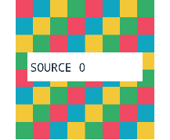
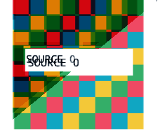
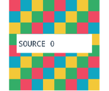

# Archium R5.2E — decisión final

**RESULTADO: NO-GO**

**AMAZON: UNRESOLVED_GRAPHICS_BLOCKER**

**CAUSA RAÍZ: NOT_PROVEN — FIX GRÁFICO: NONE — BUILD NUEVO: NO**

2026-10-19, worktree `/workspace/Archium-R5.2-forensic`, rama
`assistant/archium-r5-2-forensic`. Base:
`20da9cd994bf0f5f0548ba36864373004ab8741f`, coincidente con el recibo generado mediante
`git rev-parse 20da9cd`.

Inicio del intento: **20:08:59 UTC**. Límite absoluto: **21:38:59 UTC**.
Última captura de dispositivo: **20:19:17 UTC**. Los experimentos quedaron
detenidos dentro del límite; no se agotaron artificialmente los 90 minutos.
La falta de observabilidad de las fronteras requeridas impide cumplir GO.
Esta entrega cierra la investigación: **no habrá continuación automática ni otra fase**.

## Hallazgo principal

Se consiguió un **RED visual real y sintético**, sin Amazon ni datos privados:
la fixture existente `r52d-layer-reuse.html` muestra deformación de imágenes y
texto de sus propias imágenes en Archium. El contenido se puede reproducir
correctamente por software desde una picture de capa; el readback compuesto de
Chromium muestra el defecto. Chrome de referencia no presentó errores en las
muestras de color verificadas, pero utiliza otra versión y otro backend GPU.

Esto acota el problema, pero **no demuestra el primer estado erróneo dentro de
raster GPU → recursos/render passes → composición**. No se identificó una función
responsable ni se aplicó un parche. Un control correcto en otro navegador no es
GREEN de una corrección de Archium.

## Comparación de las cuatro fronteras solicitadas

| Punto | Qué se obtuvo realmente | Resultado y límite |
| --- | --- | --- |
| Rasterización de capas afectadas | Picture de capa y replay software con LayerTree.makeSnapshot/replaySnapshot | Fotografías y patrón sintético reconstruidos correctamente. **No es lectura del tile GPU vivo.** |
| Composición Viz/GPU | Page.captureScreenshot desde surface, más tracing Chromium | Readback con corrupción. Hay eventos de raster/render passes/swap, sin píxeles intermedios que identifiquen la primera operación errónea. |
| Buffer entregado a Android | Metadata de SurfaceFlinger de ChromeChildSurface | Surface, buffer ID y frame observados. **Píxeles del buffer: NOT_CAPTURED.** |
| Captura final del dispositivo | screencap del display físico externo | Primera toma muestra la corrupción de Amazon. Otras tomas quedaron ocluidas y fueron excluidas. La última muestra imágenes negras persistentes, con menor repetición de texto después de recuperar el foco. No es GREEN. |

No se declaran equivalentes estas capturas ni se les asigna un mismo frame ID.
Se conservaron sus intervalos temporales y puntos de origen por separado.
La última etapa visualmente correcta disponible es **un replay software nuevo**,
no un buffer GPU anterior al fallo; la primera salida visualmente incorrecta
observada es **el readback compuesto de Chromium**. El hueco entre ambas sigue
sin lectura de píxeles. Ése es el punto exacto donde termina la investigación.

La implementación fijada de PictureSnapshot asigna un bitmap limpio y reproduce
la picture. makeSnapshot también actualiza el lifecycle: observar puede modificar
el estado. La ruta de screenshot solicita redraw/copia de surface; tampoco es una
lectura pasiva del tile original. Véase la auditoría del pin en
[R5.2D](R5_2D_AMAZON_COMPOSITOR_ROOT_CAUSE.md#qué-significa-el-diferencial-de-capas).

## Evidencia de Amazon y correlación

Se reutilizó Amazon abierto. No se tocaron cuentas, compras, formularios ni
credenciales. Se usó el recolector existente y, para seleccionar las fotografías
afectadas, una copia privada que prioriza imágenes con multiply en lugar de
seleccionar primero banners sin capa propia. No se modificó el sitio como fix.

- Toma inicial: scroll **20:10:38.238–20:10:39.885Z**; captura física anterior
  **20:10:40.286–20:10:41.624Z**; sonda web
  **20:10:41.984–20:10:45.485Z**; captura física posterior
  **20:10:45.539–20:10:46.329Z**. La pantalla física y el readback muestran el
  mismo tipo de corrupción. Son una secuencia, no un frame atómico.
- SurfaceFlinger: capa **397690**, buffer **6773163425957**, frames **490** y
  **502** en las dos observaciones. Esto acredita metadata, no el contenido del
  buffer ni un defecto de reutilización por ver repetido un buffer ID.
- En la toma con traza recuperada se obtuvieron replays de las capas **71, 73 y
  79**, con metadata antes/después estable. Las capturas físicas de esa toma
  muestran otra aplicación y quedan **EXCLUDED_OTHER_APP_FOREGROUND**.
- La observación estática posterior, sin otro scroll, conservó viewport
  2256×1330 CSS, DPR 0.9606830477714539 y scrollY 1020.10754. También obtuvo
  replays; sus capturas físicas quedaron igualmente excluidas por oclusión.
- Captura física final tras traer al frente la Activity existente, sin URL nueva:
  **20:19:16.625–20:19:17.375Z**. Persisten imágenes ennegrecidas aunque se reduce
  el barrido de texto. No se confunde esta transición de foco con un fix ni se
  compara pixel a pixel con un frame anterior.

El foco/visibilidad del DOM no garantiza ausencia de otra ventana Android.
Los registros originales quedan intactos, incluidos los descartados. No se
publican capturas completas de Amazon, pestañas personales ni otras aplicaciones.

## Tracing Chromium recuperado

Se consultaron las categorías disponibles. La captura recuperada usó cc, viz,
gpu y disabled-by-default-gpu.service. Ventana de control del segundo caso:
inicio **20:12:15.777Z**, scroll **20:12:15.791–20:12:16.980Z**, tomas/sonda hasta
**20:12:25.301Z**, después cierre y lectura del stream.

El primer cierre no entregó tracingComplete antes de cerrar el cliente y no se
presenta como traza utilizable. Se confirmó que ya no estaba activo. El único
reintento de ese cierre/captura sí recuperó:

- **16,887,705 bytes**, EOF confirmado, `dataLossOccurred=false` comunicado por CDP.
- **84,192 eventos** de la instancia del navegador, no una atribución automática
  de todos los eventos a la misma imagen o frame de Amazon.
- 237 RasterTask, 237 GpuRasterBuffer::Playback y 237 DoRasterCHROMIUM.
- 227 DrawRenderPass, 226 FinishPaintRenderPass, 101 SwapBuffers de SkiaRenderer
  y 101 de SkiaOutputSurfaceImplOnGpu; dos CopyOutput.

La traza incluye IDs de layer/tile/sourceFrame y raster_id en ciertos eventos,
pero no el contenido de los tiles ni la asociación completa de cada operación
con los píxeles afectados y el buffer Android. No se deduce corrección por contar
operaciones ni se deduce un fallo de fences por diferencias en sus conteos.
La falta de pérdida declarada de esta traza no elimina las limitaciones de captura.

## Fixture y referencia: RED reproducible, causa aún abierta

Se ejecutó la fixture existente, intacta: 96 tarjetas, dieciséis PNG 768²,
sticky/fixed, transformaciones, multiply, reciclaje/scroll y resize. Las **96
imágenes** reportaron decodificación en los estados registrados. Pestañas,
forwards y servidores propios se cerraron después del ensayo.

El primer contraste reveló una diferencia de geometría efectiva pese a solicitar
los mismos parámetros de emulación; no se trató como comparación equivalente.
Se normalizó con las medidas reales antes de cerrar el contraste:

| Navegador | Versión / backend observado | Viewport CSS / DPR medidos |
| --- | --- | --- |
| Archium | 157.0.8086.0 / GraphiteDawnVulkan | 1799×900 / 0.9998598818 |
| Chrome Android | 149.0.7827.102 / GaneshGL | 1800×900 / 1.0000000159 |

Queda una diferencia de un CSS px y una diferencia pequeña de DPR. **No se
comparan los bitmaps completos como si fueran idénticos.** Cada imagen se mide
con sus propios bounds/DPR contra los colores conocidos de la fixture. La
comparación entre versiones/backends es un control, no una atribución a Graphite.

Oracle de muestras: centros de ocho columnas y filas 0,1,2,5,6,7 del checker,
excluyendo la banda de texto; object-fit:contain centrado con tamaño min(w,h).
Conversión a píxeles con DPR medido. Palette RGB: (239,73,99), (16,166,194),
(243,200,56), (52,174,104), índice (fila+columna+imagen+fase) mod 4.
Tolerancia máxima por canal: 12. Se incluyen sólo imágenes dentro del viewport,
fuera del header/footer: **14 imágenes, 672 muestras por estado**.

| Estado, fase 0 | Archium: muestras incorrectas | Chrome: muestras incorrectas |
| --- | --- | --- |
| Antes del ciclo | 129 / 672 | 0 / 672 |
| Tras scroll/reciclaje y retorno | 138 / 672 | 0 / 672 |
| Tras resize y restauración | 55 / 672 | 0 / 672 |

Este RED detecta corrupción de la fixture, no mide el porcentaje total de
píxeles corruptos de Amazon. La reducción después de resize no constituye GREEN.
La picture de la imagen sintética recuperada en capa 11 se reproduce correctamente
por software; otros snapshots corresponden a contenedores y no se confunden con
la imagen. Imágenes siguientes: **recortes sintéticos**, con dimensiones/puntos
del pipeline diferentes; no son una pareja de readbacks GPU.

| Replay software de la imagen | Readback compuesto Archium | Control Chrome |
| --- | --- | --- |
|  |  |  |

## Criterios de decisión

| Requisito GO | Resultado |
| --- | --- |
| Primera etapa defectuosa demostrada | NO: primera salida incorrecta observada, sin primera transición causal |
| Código responsable identificado | NO |
| RED pertinente | SÍ para corrupción sintética; NO para una causa concreta del código |
| Corrección mínima | NO, no se aplica parche especulativo |
| GREEN de la corrección | NO |
| Ausencia de regresiones conocidas de un fix | NO EVALUABLE, no hay fix gráfico |

Las herramientas usadas no proporcionaron readback de tiles GPU vivos ni de
píxeles de la Surface individual entregada a Android. screencap ofrece captura
de display, no ese buffer aislado. SurfaceFlinger permitió metadata. No se afirma
que sea imposible obtener esos datos en cualquier infraestructura; **no se
obtuvieron en este entorno y en esta ejecución**. No se sustituyeron por replay,
por resultados simulados ni por permisos privilegiados.

## Estado preservado y SHA final

- **Amazon:** UNRESOLVED_GRAPHICS_BLOCKER. Abierto, sin GREEN, sin workaround.
- **Sidebar/reordenamiento:** corrección previa preservada; no se repitieron
  drags ni se recertificó su matriz visual durante este intento. No hay cambios
  nuevos de geometría, selección o identidad de pestañas.
- **Diálogos:** fix aislado **51847556e761ca0600a4aa824531e40d200fdf17**, intacto.
  La APK instalada documentada no lo contiene. Su GREEN visual en Galaxy sigue
  pendiente; los PASS source-level históricos no equivalen a instalación validada.
- **Código de producto:** sin diff nuevo frente a la base 20da9cd. Sin cambios de
  pin Chromium, GN args, toolchain, GPU flags, package, JNI ni Portal.
- **QEMU:** QEMU_ABI_BLOCKED preservado; no se declaró una ejecución QEMU.
- **Supervisor:** no modificado, no duplicado ni reactivado para nuevos runs.
- **Rama activa:** se conserva 3db367adff50d423b8c4475d10165d2790f6065a, sin integrar
  el worktree forense. Outputs y checkpoints no se tocaron.

SHA final del registro de evidencia y decisión en TODO:
**06066b28f802a7e3f13a52197835e579c726d47c**. Este informe se añade sobre ese commit;
el SHA del commit documental se obtiene con
`git log -1 --format=%H -- docs/validation/R5_2_FINAL_GO_NO_GO.md` y se entrega al
usuario al cerrar. No existe SHA de un nuevo fix gráfico porque no se implementó.

**DECISIÓN SOBRE COMPILACIÓN: NO DESPACHAR.** No se propone un build como prueba
de un fix de Amazon inexistente. No se compiló Chromium, no hubo clean/purge ni
eliminación de checkpoints. La decisión sobre cualquier integración posterior
queda exclusivamente en manos del usuario. No se inician más experimentos.

[Recibo depurado, conteos y hashes](r52e/evidence.json). Originales privados:
`/workspace/macdesk-maintenance/archium-r52e/`, incluidos scripts exactos,
metadata, replay, PNG, dump y traza. Se preservan los originales previos R5.2–R5.2D.
